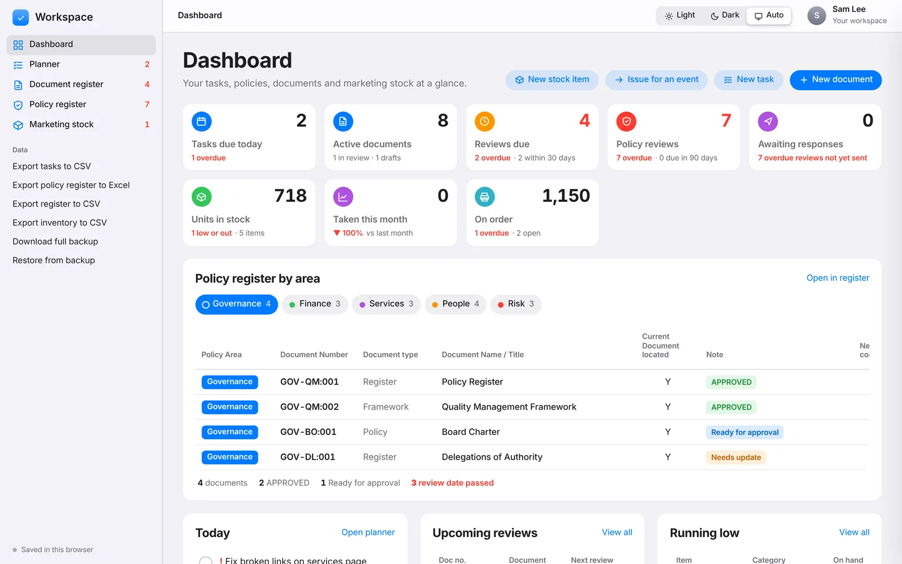

# Workspace

**A free app for documents, policies, marketing stock and planning, in a single HTML file.**

Workspace brings together the registers that small teams usually keep in separate spreadsheets: a document register, a policy register, marketing stock control and a task planner. It runs entirely in your browser. There's no sign-up, no server and no tracking.



## Features

### Dashboard
- Tasks due today, reviews due, policy reviews, stock on hand and orders, at a glance
- Overdue items flagged, with what's coming up next
- Light, dark and automatic appearance

### Planner
- My day, grid, board, calendar and charts views
- Buckets, labels, priorities, subtasks, comments, links and repeating tasks
- Group by bucket, progress, priority, due date, label or person
- Send a document for review or approval and track who it's with

### Document register
- Reference numbers, categories, classification and status
- Major and minor versions, with the previous version kept alongside
- Check out and check in
- Review cycles, full change history, table and board views
- Export to CSV or Excel

### Policy register
- Policies, procedures, forms and plans across governance, finance, services, people and risk
- Eight stages from "to be developed" to "retired", on a drag-and-drop approval pipeline
- Risk ratings, approval levels, owners and review cycles
- Review schedule, review tracker, insights and data checks
- Import from a spreadsheet, export to Excel
- A sample framework you can load to try it out

### Marketing stock
- Inventory with reorder levels, locations, suppliers and unit costs
- Reorder planner that suggests what to reprint and when, allowing for lead time
- Print and merchandise orders, from quote to delivery
- Issue stock to events and see what each event cost
- Stock takes, people and department totals

## Use it

- **Hosted:** open the GitHub Pages site and click **Open the app**.
- **Offline:** download [`app/index.html`](app/index.html) and open it in any modern browser.

Your data is saved in your browser's local storage. Use **Download full backup** in the sidebar regularly, and **Restore from backup** to move your data to another browser or computer.

The Excel import and export load [SheetJS](https://sheetjs.com) from a CDN, so they need an internet connection. Everything else works offline.

## Deploy to Vercel (free)

**Option A: from GitHub (updates automatically)**
1. Push this folder to a GitHub repository.
2. Go to [vercel.com/new](https://vercel.com/new) and import the repository.
3. Leave **Framework Preset** as **Other**, with no build command and no output directory.
4. Click **Deploy**. Your site is live at `https://<project-name>.vercel.app` in under a minute.

Every push to `main` redeploys the site.

**Option B: from your computer**
```
npm i -g vercel
cd workspace
vercel --prod
```
Accept the defaults when asked. `vercel.json` already sets clean URLs and caching.

## Publish your own copy with GitHub Pages

1. Fork or push this repository to GitHub.
2. Go to **Settings → Pages**.
3. Under **Build and deployment**, choose **Deploy from a branch**, then pick `main` and `/ (root)`.
4. After a minute your site is live at `https://<your-username>.github.io/<repo-name>/`.

The landing page works out the repository link automatically on GitHub Pages. If you host it somewhere else (Vercel, Netlify, your own server), set `REPO_URL` near the bottom of `index.html`.

## Customise

Categories, departments, document types, statuses, policy areas and stages are plain lists near the top of the script in `app/index.html` (look for `const CATS=`, `const DEPTS=`, `const POL_AREAS=` and so on). Edit them in any text editor and reload.

## Project structure

```
vercel.json         Vercel settings
index.html          Landing page
app/index.html      The Workspace app (self-contained)
assets/screens/     Screenshots used on the landing page
```

## Licence

MIT. See [LICENSE](LICENSE).
